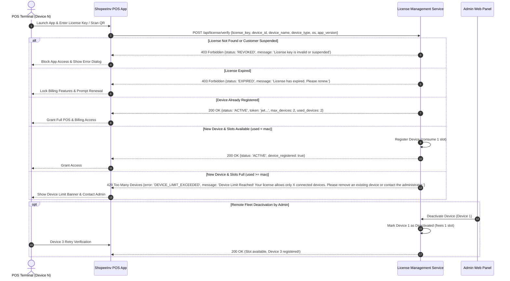

# ShopeeInv POS Application – License Verification & Device Binding Integration

This guide explains how the **ShopeeInv POS client application** (`lib/`) integrates with the centralized **ShopeeInv License Management System** to authenticate licenses, bind hardware devices, and enforce multi-terminal limits.

---

## 1. Authentication & Device Handshake Flow



---

## 2. Recommended Dart Client Service for ShopeeInv POS

You can place this client service in `lib/core/services/license_client_service.dart` in the main POS project:

```dart
import 'dart:io';
import 'package:device_info_plus/device_info_plus.dart';
import 'package:package_info_plus/package_info_plus.dart';
import 'package:shared_preferences/shared_preferences.dart';

class LicenseVerificationResult {
  final bool isAllowed;
  final String status;
  final String? errorMessage;
  final int maxDevices;
  final int activeDevices;

  LicenseVerificationResult({
    required this.isAllowed,
    required this.status,
    this.errorMessage,
    this.maxDevices = 0,
    this.activeDevices = 0,
  });
}

class LicenseClientService {
  static const String _prefLicenseKey = 'shopeeinv_saved_license_key';
  static const String _prefDeviceId = 'shopeeinv_unique_device_id';

  /// Collects unique hardware identity
  static Future<Map<String, String>> getHardwareIdentity() async {
    final prefs = await SharedPreferences.getInstance();
    String? deviceId = prefs.getString(_prefDeviceId);

    if (deviceId == null) {
      // Generate persistent unique hardware UUID
      deviceId = 'dev_${DateTime.now().millisecondsSinceEpoch}_${Platform.operatingSystem}';
      await prefs.setString(_prefDeviceId, deviceId);
    }

    final packageInfo = await PackageInfo.fromPlatform();
    final devInfo = DeviceInfoPlugin();

    String deviceName = Platform.localHostname;
    String deviceType = Platform.isAndroid || Platform.isIOS ? 'Mobile' : 'Desktop';
    String os = Platform.operatingSystemVersion;

    return {
      'deviceId': deviceId,
      'deviceName': deviceName,
      'deviceType': deviceType,
      'os': os,
      'appVersion': packageInfo.version,
    };
  }

  /// Verifies license against server / backend
  static Future<LicenseVerificationResult> verifyAndRegister({
    required String licenseKey,
  }) async {
    final hardware = await getHardwareIdentity();

    // Call your centralized licensing API or Firebase Function:
    // final response = await http.post(
    //   Uri.parse('https://your-admin-backend/api/license/verify'),
    //   body: jsonEncode({
    //     'licenseKey': licenseKey,
    //     ...hardware,
    //   }),
    // );

    // If status == 'DEVICE_LIMIT_EXCEEDED':
    // return LicenseVerificationResult(
    //   isAllowed: false,
    //   status: 'DEVICE_LIMIT_EXCEEDED',
    //   errorMessage: 'Device Limit Reached! Your license allows only 2 connected devices. '
    //                 'Please remove an existing device or contact the administrator.',
    // );

    return LicenseVerificationResult(isAllowed: true, status: 'ACTIVE');
  }
}
```

---

## 3. UI Error Handling Example

When the verification response indicates device limit exceeded, display the required user-facing notification:

```dart
if (!result.isAllowed) {
  showDialog(
    context: context,
    barrierDismissible: false,
    builder: (ctx) => AlertDialog(
      title: const Row(
        children: [
          Icon(Icons.warning_amber_rounded, color: Colors.amber),
          SizedBox(width: 8),
          Text('Device Limit Reached'),
        ],
      ),
      content: Text(
        result.errorMessage ??
        'Device Limit Reached! Your license allows only ${result.maxDevices} connected devices. '
        'Please remove an existing device or contact the administrator.',
      ),
      actions: [
        TextButton(
          onPressed: () => Navigator.of(ctx).pop(),
          child: const Text('OK'),
        ),
      ],
    ),
  );
}
```
